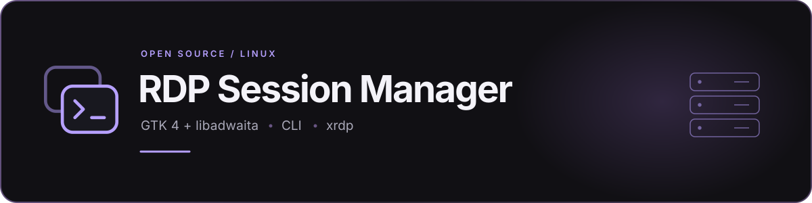
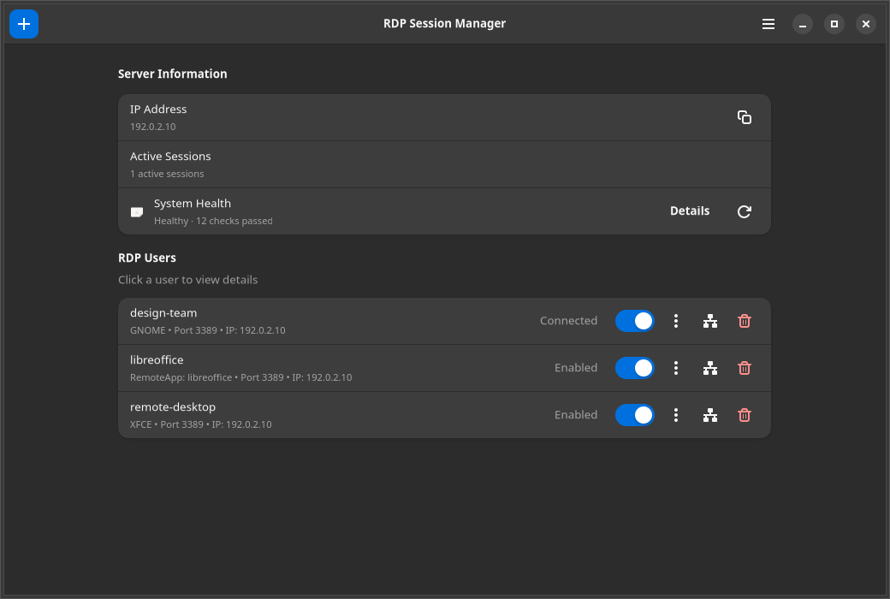
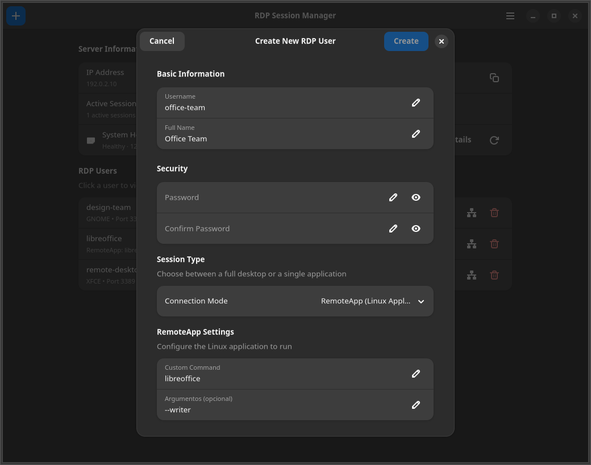
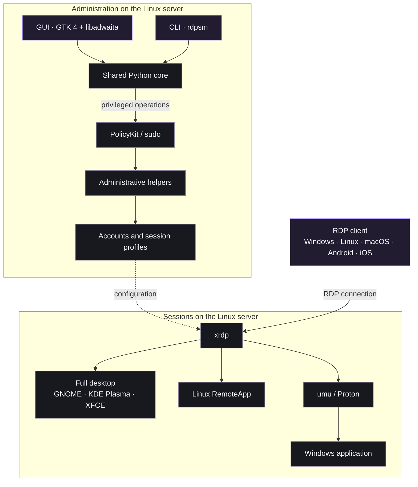
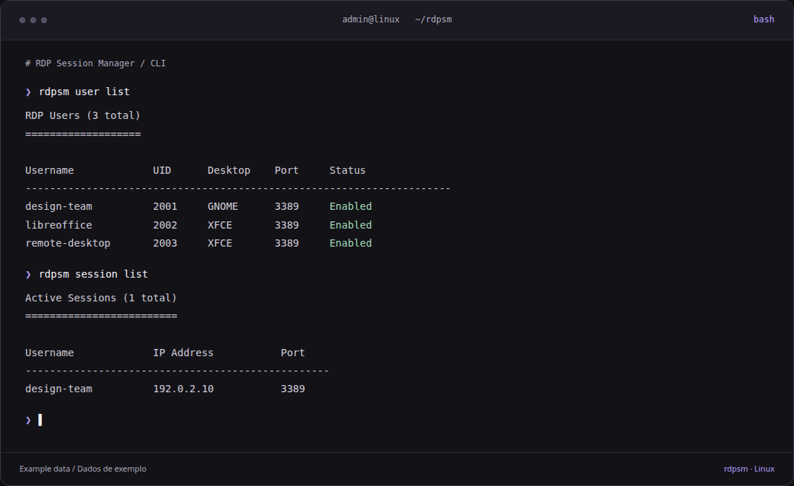

<div align="center">



### Your RDP server. Under control.

Manage users, desktops and remote applications in a native Linux interface.<br>Use the GUI on your desktop and the CLI in your automation workflows.

[Português](README.md) · **English**

[](https://github.com/Pedroltz/RDP-SessionManager/releases/latest) [](LICENSE) [](https://www.python.org/) [](https://www.gtk.org/) [](https://github.com/Pedroltz/RDP-SessionManager/actions/workflows/deploy-pages.yml)

[**Official website ↗**](https://pedroltz.github.io/RDP-SessionManager/) · [Install](#quick-install) · [Terminal](#in-the-terminal) · [How it works](#how-it-works) · [Documentation](#documentation)

</div>

## Meet the project

**RDP Session Manager** brings **xrdp** administration into one place: user accounts, connection profiles, desktops, applications and diagnostics. The interface uses **GTK 4 and libadwaita**; the `rdpsm` CLI lets you manage from a terminal, including on headless servers.

The administration application runs on the **Linux server**. Users connect to sessions through a compatible RDP client on Windows, Linux, macOS, Android or iOS.

## The interface in action

### Users, sessions and server health

See RDP accounts, connection status and the system health summary in a single window.

[](imgs/readme/dashboard.png)

*Actual application interface with sample data. Click the image to enlarge.*

<details>
<summary><strong>See user creation and remote application configuration</strong></summary>

Choose a full desktop, Linux RemoteApp or a compatible Windows application. This example prepares a LibreOffice Writer session.

[](imgs/readme/create-user.png)

*Example data; no accounts are created while capturing the image.*

</details>

## What you can do

| Feature | In practice |
| --- | --- |
| **Users and sessions** | Create, enable, disable and remove accounts; monitor and end sessions. |
| **Desktops and RemoteApps** | Offer GNOME, KDE Plasma or XFCE, or launch a Linux application per session. |
| **Windows applications** | Use umu/Proton for compatible applications, with support for legacy WineGE profiles. |
| **CLI and automation** | Administer with `rdpsm` and query table or JSON output. |
| **Integrated diagnostics** | Inspect host, user and session health through the GUI or CLI. |
| **Repair and audit** | Review repair plans, roll back managed files on failure and export audit events as JSONL. |

## How it works

Administration and remote access follow separate paths: **the GUI and CLI configure the server; the RDP client connects to xrdp**.



- **Shared logic:** the GUI and CLI use the Python modules for users, configuration, monitoring and diagnostics.
- **Authentication when needed:** administrative operations use helpers with PolicyKit in a graphical session or sudo in a terminal.
- **A session for each workflow:** xrdp starts the configured desktop or application. Windows applications depend on runtime compatibility; WineGE remains a legacy option.

RemoteApp provides an application inside an xrdp session; it does not imply Windows seamless/RAIL integration. See the [server mode](docs/SERVER_MODE.md) and [Windows applications](docs/WINDOWS_APPS.md) guides for details.

## Quick install

On the Linux server, run the official installer:

```bash
curl -fsSL https://github.com/Pedroltz/RDP-SessionManager/releases/latest/download/install.sh | bash
```

The installer detects the distribution, verifies release assets and guides dependency installation. Then open **RDP Session Manager** from the application menu or terminal:

```bash
rdp-session-manager
```

See the [installation guide](docs/INSTALL.md) for installer options, manual installation and troubleshooting.

## In the terminal

List accounts and sessions without opening the graphical interface:

[](imgs/readme/cli.png)

*Output from the actual CLI methods, run with sample data. Click to enlarge.*

```bash
# RDP accounts and active sessions
rdpsm user list
rdpsm session list

# Host, user and session diagnostics
rdpsm health

# JSON for scripts and monitoring
rdpsm user list --format json
rdpsm health --format json
```

The same CLI also manages profiles, dependencies, server configuration and Windows applications. See commands and examples in the [CLI reference](docs/CLI.md).

## Compatibility

| Component | Support |
| --- | --- |
| **Linux server** | Ubuntu 22.04+, Debian 12+, Arch Linux and supported derivatives. |
| **Graphical interface** | Python 3.9+, GTK 4 and libadwaita. |
| **Remote access** | xrdp and an RDP client compatible with the session type. |
| **Desktops** | GNOME, KDE Plasma and XFCE. |
| **Windows applications** | umu/Proton runtime; compatibility depends on the application. WineGE for legacy profiles. |

Privileged administration uses PolicyKit or sudo depending on the environment. Capacity requirements depend on the workload; consult [server mode](docs/SERVER_MODE.md) before sizing a deployment. Arch is an experimental target for that mode.

## Documentation

| I want to… | Where to look |
| --- | --- |
| Install or upgrade | [Installation guide](docs/INSTALL.md) |
| Administer from a terminal | [CLI reference](docs/CLI.md) |
| Install and validate Windows applications | [Windows applications](docs/WINDOWS_APPS.md) |
| Understand existing WineGE profiles | [Legacy WineGE guide](docs/WINEGE_REMOTEAPP.md) |
| Prepare a headless server | [Server mode](docs/SERVER_MODE.md) |
| Investigate a problem | [Troubleshooting](docs/TROUBLESHOOTING.md) |
| Understand development and publishing | [Development](docs/DEVELOPMENT.md) · [CI/CD](docs/CI.md) |
| Follow changes and next steps | [Changelog](CHANGELOG.md) · [Roadmap](docs/ROADMAP_V0.7.md) |

## Contribute

Bug reports, documentation improvements and code contributions are welcome. Open an [issue](https://github.com/Pedroltz/RDP-SessionManager/issues) with the problem context or submit a pull request with a focused change.

<details>
<summary><strong>Run from a development clone</strong></summary>

With the project dependencies installed, run from the repository root:

```bash
./run.sh

# Alternative: start the interface directly
python3 src/main.py
```

See the [installation](docs/INSTALL.md) and [development](docs/DEVELOPMENT.md) guides to prepare your environment.

</details>

## License

Distributed under the [GNU General Public License v3.0](LICENSE).
