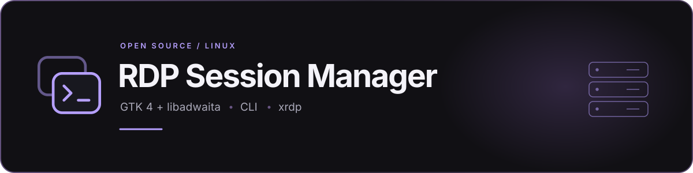
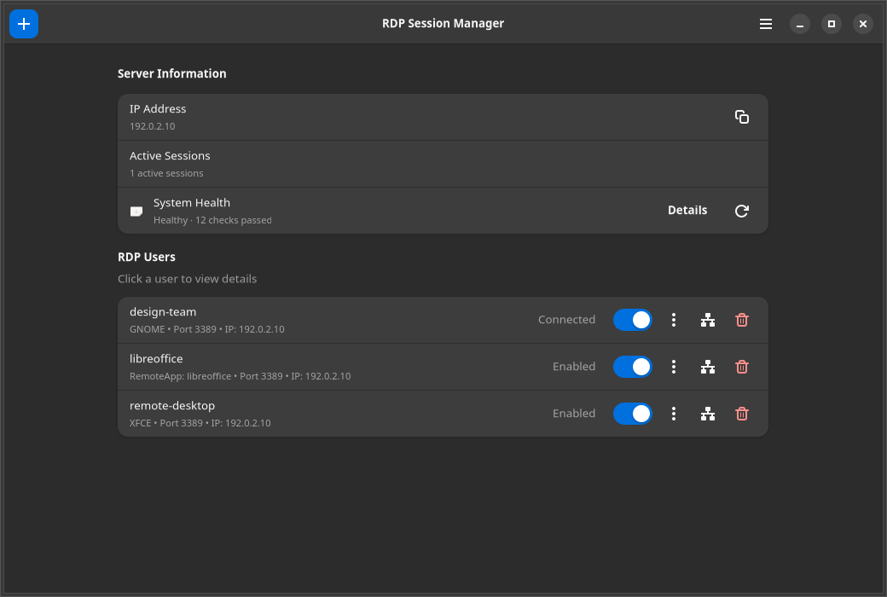
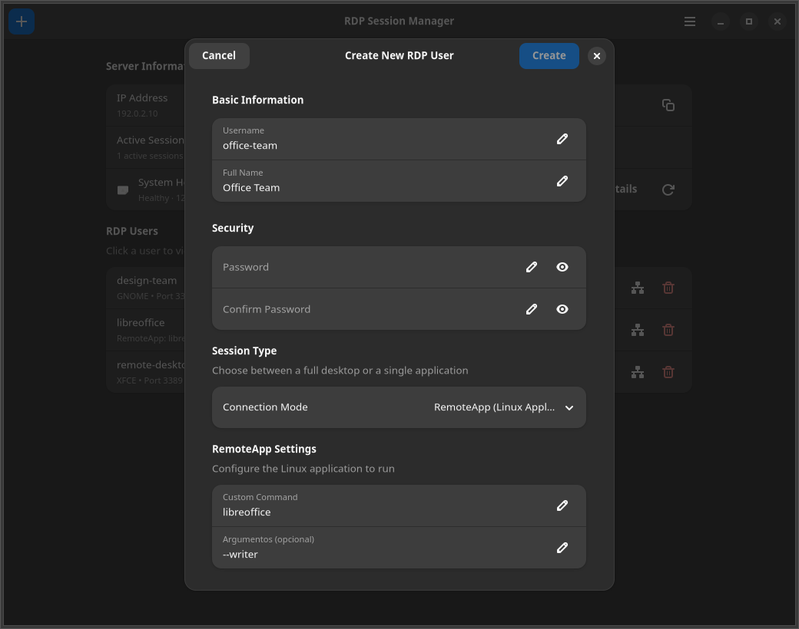
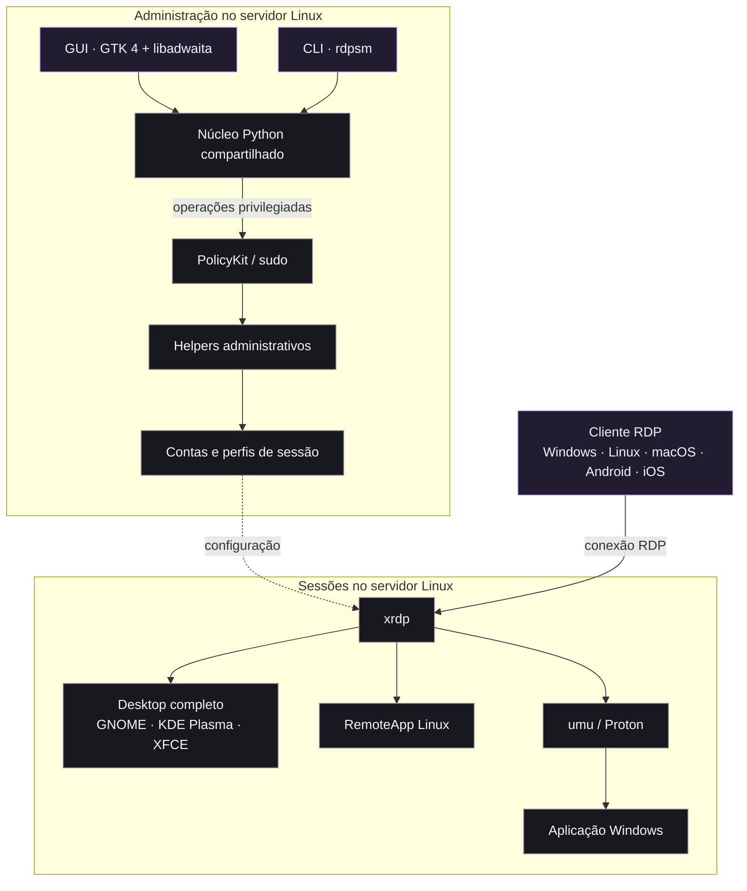
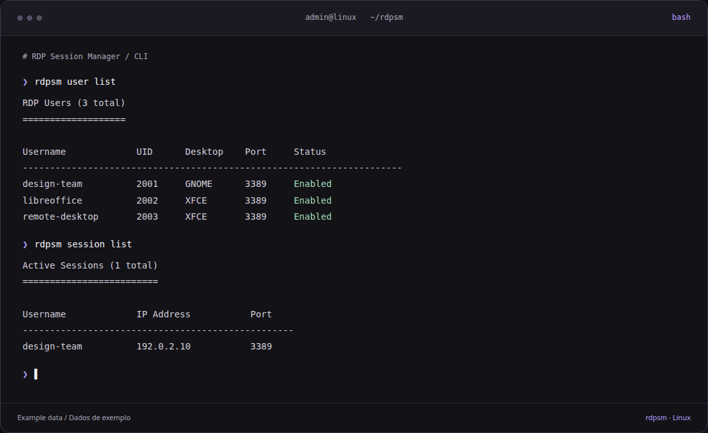

<div align="center">



### Seu servidor RDP. Tudo sob controle.

Gerencie usuários, desktops e aplicações remotas em uma interface nativa para Linux.<br>Use a GUI no desktop e a CLI nas suas rotinas de automação.

**Português** · [English](README.en.md)

[](https://github.com/Pedroltz/RDP-SessionManager/releases/latest) [](LICENSE) [](https://www.python.org/) [](https://www.gtk.org/) [](https://github.com/Pedroltz/RDP-SessionManager/actions/workflows/deploy-pages.yml)

[**Site oficial ↗**](https://pedroltz.github.io/RDP-SessionManager/) · [Instalação](#instalação-rápida) · [Terminal](#no-terminal) · [Como funciona](#como-funciona) · [Documentação](#documentação)

</div>

## Conheça o projeto

O **RDP Session Manager** centraliza a administração de acesso remoto via **xrdp**: contas de usuários, perfis de conexão, desktops, aplicações e diagnósticos. A interface usa **GTK 4 e libadwaita**; a CLI `rdpsm` permite administrar pelo terminal, inclusive em servidores sem ambiente gráfico.

O aplicativo de administração roda no **servidor Linux**. Os usuários acessam as sessões com um cliente RDP compatível, a partir de Windows, Linux, macOS, Android ou iOS.

## A interface, na prática

### Usuários, sessões e saúde do servidor

Veja as contas RDP, o estado das conexões e o resumo de saúde do sistema em uma única janela.

[](imgs/readme/dashboard.png)

*Captura da interface real com dados de exemplo. Clique na imagem para ampliar.*

<details>
<summary><strong>Ver a criação de usuário e a configuração de uma aplicação remota</strong></summary>

Escolha entre desktop completo, RemoteApp Linux ou uma aplicação Windows compatível. Neste exemplo, o formulário prepara uma sessão do LibreOffice Writer.

[](imgs/readme/create-user.png)

*Dados fictícios; nenhuma conta é criada durante a captura.*

</details>

## O que você pode fazer

| Recurso | Na prática |
| --- | --- |
| **Usuários e sessões** | Criar, habilitar, desabilitar e remover contas; acompanhar e encerrar sessões. |
| **Desktops e RemoteApps** | Oferecer GNOME, KDE Plasma ou XFCE, ou iniciar uma aplicação Linux por sessão. |
| **Aplicações Windows** | Usar umu/Proton para aplicações compatíveis, com suporte a perfis WineGE legados. |
| **CLI e automação** | Administrar com `rdpsm` e consultar dados em tabela ou JSON. |
| **Diagnóstico integrado** | Inspecionar a saúde do host, dos usuários e das sessões pela GUI ou CLI. |
| **Reparo e auditoria** | Revisar planos de reparo, restaurar arquivos gerenciados em caso de falha e exportar eventos de auditoria em JSONL. |

## Como funciona

A administração e a conexão remota têm caminhos próprios: **GUI e CLI configuram o servidor; o cliente RDP se conecta ao xrdp**.



- **Uma lógica compartilhada:** GUI e CLI usam os módulos Python de usuários, configuração, monitoramento e diagnóstico.
- **Autenticação quando necessária:** operações administrativas usam helpers com PolicyKit na sessão gráfica ou sudo no terminal.
- **Uma sessão por fluxo de trabalho:** o xrdp inicia o desktop ou a aplicação configurada. Aplicações Windows dependem da compatibilidade com o runtime; WineGE fica como opção legada.

RemoteApp oferece uma aplicação dentro de uma sessão xrdp; não significa integração seamless/RAIL do Windows. Consulte os guias de [modo servidor](docs/SERVER_MODE.md) e [aplicações Windows](docs/WINDOWS_APPS.md) para os detalhes.

## Instalação rápida

No servidor Linux, execute o instalador oficial:

```bash
curl -fsSL https://github.com/Pedroltz/RDP-SessionManager/releases/latest/download/install.sh | bash
```

O instalador detecta a distribuição, verifica os artefatos e orienta a instalação das dependências. Depois, abra **RDP Session Manager** pelo menu de aplicativos ou pelo terminal:

```bash
rdp-session-manager
```

Para opções do instalador, instalação manual e solução de problemas, veja o [guia de instalação](docs/INSTALL.md).

## No terminal

Liste contas e sessões sem abrir a interface gráfica:

[](imgs/readme/cli.png)

*Saída dos métodos reais da CLI, executados com dados fictícios. Clique para ampliar.*

```bash
# Contas RDP e sessões ativas
rdpsm user list
rdpsm session list

# Diagnóstico do host, dos usuários e das sessões
rdpsm health

# JSON para scripts e monitoramento
rdpsm user list --format json
rdpsm health --format json
```

A mesma CLI também gerencia perfis, dependências, configuração do servidor e aplicações Windows. Veja os comandos e exemplos na [referência da CLI](docs/CLI.md).

## Compatibilidade

| Componente | Suporte |
| --- | --- |
| **Servidor Linux** | Ubuntu 22.04+, Debian 12+, Arch Linux e derivados suportados. |
| **Interface gráfica** | Python 3.9+, GTK 4 e libadwaita. |
| **Acesso remoto** | xrdp e um cliente RDP compatível com o tipo de sessão. |
| **Desktops** | GNOME, KDE Plasma e XFCE. |
| **Aplicações Windows** | Runtime umu/Proton; compatibilidade depende da aplicação. WineGE para perfis legados. |

A administração privilegiada usa PolicyKit ou sudo, conforme o ambiente. Os requisitos de capacidade variam com a carga; consulte o [modo servidor](docs/SERVER_MODE.md) antes de dimensionar uma implantação. Nesse modo, Arch é um alvo experimental.

## Documentação

| Quero… | Onde encontrar |
| --- | --- |
| Instalar ou atualizar | [Guia de instalação](docs/INSTALL.md) |
| Administrar pelo terminal | [Referência da CLI](docs/CLI.md) |
| Instalar e validar aplicações Windows | [Aplicações Windows](docs/WINDOWS_APPS.md) |
| Entender perfis WineGE existentes | [Guia legado do WineGE](docs/WINEGE_REMOTEAPP.md) |
| Preparar um servidor sem interface gráfica | [Modo servidor](docs/SERVER_MODE.md) |
| Investigar um problema | [Solução de problemas](docs/TROUBLESHOOTING.md) |
| Entender desenvolvimento e publicação | [Desenvolvimento](docs/DEVELOPMENT.md) · [CI/CD](docs/CI.md) |
| Acompanhar mudanças e próximos passos | [Changelog](CHANGELOG.md) · [Roadmap](docs/ROADMAP_V0.7.md) |

## Contribua

Relatos de problemas, melhorias na documentação e contribuições de código são bem-vindos. Abra uma [issue](https://github.com/Pedroltz/RDP-SessionManager/issues) com o contexto do problema ou envie um pull request com uma mudança focada.

<details>
<summary><strong>Executar a partir de um clone de desenvolvimento</strong></summary>

Com as dependências do projeto instaladas, na raiz do repositório:

```bash
./run.sh

# Alternativa: iniciar a interface diretamente
python3 src/main.py
```

Consulte os guias de [instalação](docs/INSTALL.md) e [desenvolvimento](docs/DEVELOPMENT.md) para preparar o ambiente.

</details>

## Licença

Distribuído sob a [GNU General Public License v3.0](LICENSE).
